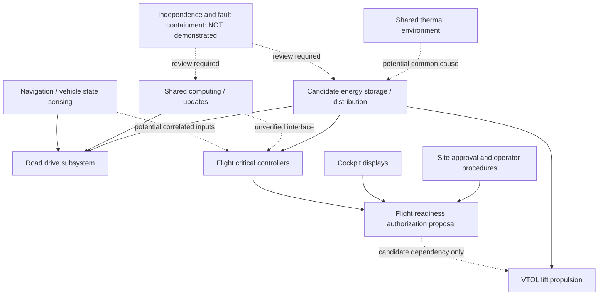
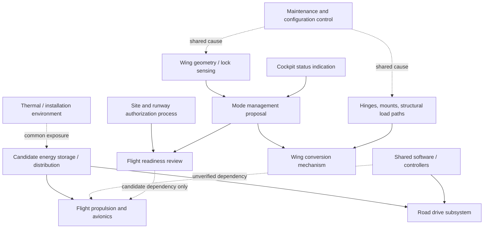

# VELTARO V1 — Architecture dependency diagrams (concept v0.1)

**UNREVIEWED research schematics only.** Boxes and arrows are hypothetical dependencies, **not** selected hardware, validated independence, safe operating logic, wiring, or certifiable architecture.

## VTOL candidate — cross-mode dependencies

**Research blockers:** common energy distribution (CCA-01), shared computing or updates (CCA-02/05), sensing and HMI (CCA-03/04), thermal influence (CCA-06), maintenance (CCA-08). Need separate failure/containment arguments for loss of lift and energy reserves (HZ-05, HZ-08, HZ-12).

## Transforming-wing / runway candidate — cross-mode dependencies

**Research blockers:** lock structural verification (HZ-04 / CCA-07), sensor and mode status disagreement (CCA-03/04), conversion safety (HZ-03), runway performance (HZ-06), shared energy and maintenance (CCA-01/08).

## Candidate separation questions

| ID | Architecture | Interface or dependency to resolve | Related common cause | Evidence missing |
|---|---|---|---|---|
| DEP-01 | VTOL | Shared power vs flight critical power continuity | CCA-01 / CCA-06 | Electrical single-line and hazard-reviewed power path |
| DEP-02 | VTOL | Flight control independence from road computer and updates | CCA-02 / CCA-05 | Interface inventory, failure isolation analysis |
| DEP-03 | VTOL | Correlated navigation and state sensor faults | CCA-03 | Sensor architecture and common-mode assessment |
| DEP-04 | VTOL | Operator/site approval vs display ready indications | CCA-04 | Human factors and authorization proof |
| DEP-05 | Transforming wing | Wing lock proof vs common structural failure | CCA-07 | Mechanical drawings, structural tests and safety case |
| DEP-06 | Transforming wing | Controller/sensor agreement on conversion state | CCA-02 / CCA-03 / CCA-05 | Independent system review and fault test plan |
| DEP-07 | Transforming wing | Conversion lockout vs road/flight permission | CCA-04 / CCA-08 | Formal transition/maintainability review |
| DEP-08 | Both | Shared power, cooling and maintenance dependencies | CCA-01 / CCA-06 / CCA-08 | Zonal, thermal, common-cause engineering assessment |

These are not approved design interfaces. No dependency is proven safely independent.

## Next review gate

Freeze a specific architecture and operational concept, assign system owners, enumerate physical and logical interfaces, and have qualified aerospace/automotive safety engineers assess zonal and common-cause failures before detailed design or simulation claims.
