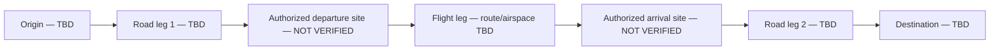

# VELTARO V1 — M-01 common-input scenario, revision 0.1

**20 October 2026 · UNVERIFIED CONCEPT / HOLD BOTH.** This package makes the earlier [M-01 protocol](VELTARO-V1-Reference-Mission-M01-2026.md) machine-checkable. It does **not** select cities, provide route authorization, validate vehicle performance or claim any legal flight site.

## Common journey framework

Both concepts must be assessed for the **same origin, destination, jurisdiction, occupants, luggage, environmental assumptions and end-to-end service requirement**. Legal departure/arrival facilities differ by architecture. No inference is made that one physical site supports both operations.

## Input rules

The structured [M-01 scenario JSON](../engineering/v1-m01-common-mission.json) deliberately leaves unverified numerical and geographic parameters `null`. Unknown values are not silently converted to zero.

| Domain | Shared input that must eventually be sourced | Candidate-specific distinction |
|---|---|---|
| Geography | Jurisdiction, origin/destination, road legs, air route | Verified runway versus vertical facility access |
| Payload | Occupants and mass, luggage, base vehicle assumptions | Architecture mass ledgers differ |
| Weather | Wind and operating conditions | Distinct validated envelopes |
| Energy | Usable **pack-level** specific energy and reserve basis | Hover/transition versus runway and wing-borne phases |
| Regulation | Actual road and aviation authorization pathway | Aircraft category and site constraints |
| Safety | Review status and traceable hazards | VTOL HZ-05; transforming wing HZ-04/HZ-06 |

**Before replacing any null:** include source, date, unit, confidence and applicability in the evidence register. Do not treat arbitrary estimates as verified inputs.

## Comparison gate

`tests/v1-m01-common-mission.mjs` checks scenario shape and shared-field discipline. It is a **data-quality test**, not a safety test. A future non-HOLD decision requires legal site evidence, common payload conditions, architecture-specific mass/energy closure and independent review. No purchasing or external outreach is authorized.
