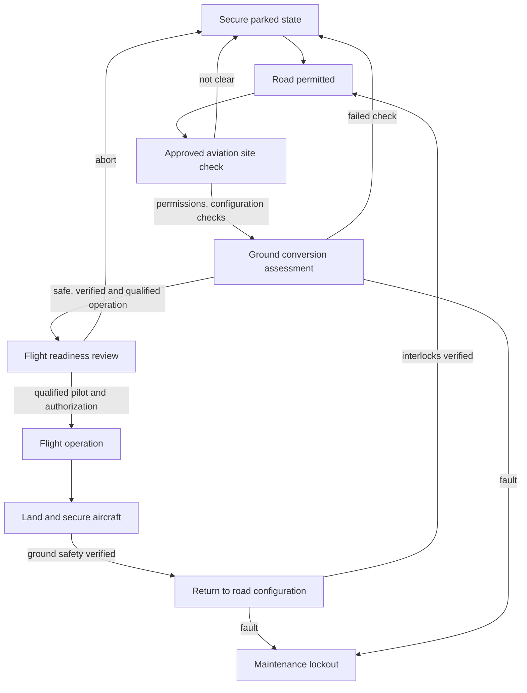

# VELTARO V1 — Mode management concept v0.1
**Not certified flight logic; functional brainstorming only; no implementation for actual vehicles**

## Design requirements to investigate
- No transition into flight readiness while road traffic is active.
- Configuration sensors should not be assumed sufficient by themselves; evaluate fail-safe design, diagnostics, independent confirmation and maintenance processes.
- Abort path before takeoff, fault recording, operator alerts and maintenance lockout.
- Uncontrolled loss of electrical power, flight mode sensor disagreement and mechanism failures are safety-critical questions requiring a qualified system safety process.
- Mode UI must distinguish “requested,” “checking,” “authorized” and “ready” states; never imply the dashboard can grant legal flight permission.

## Open questions
Do not specify interlock wiring, control algorithms or flight operating envelopes without architecture decisions, verification plans and qualified engineering. This is **not** an operational safety system.
