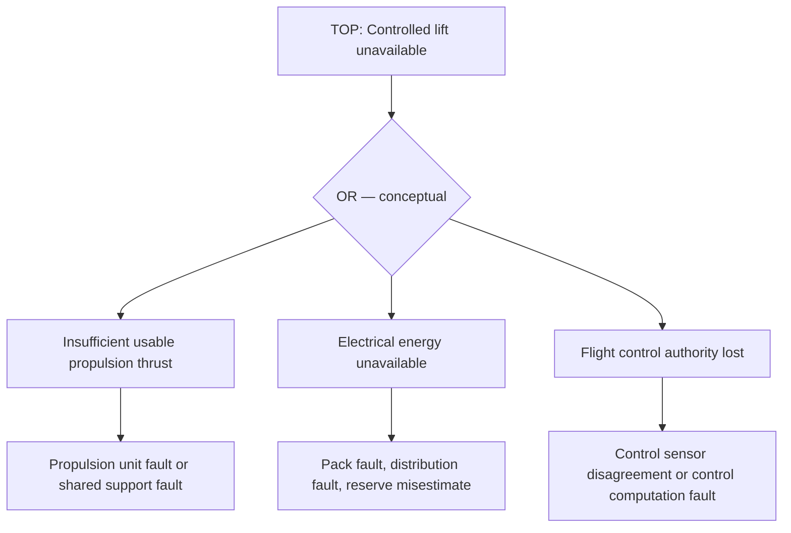
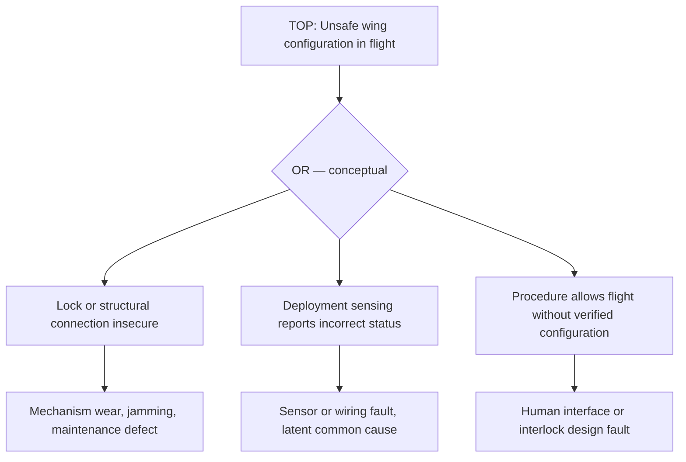
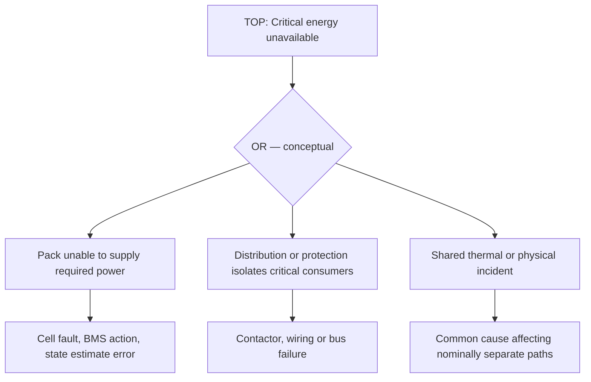
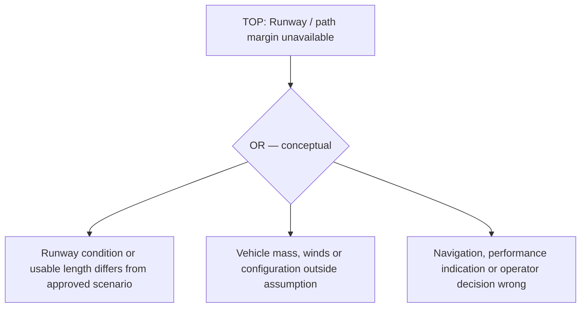

# VELTARO V1 — Preliminary failure-tree study (concept only)

**20 October 2026 · UNREVIEWED · NOT operational flight-safety evidence**

These qualitative *fault-tree sketches* explore potential initiating conditions and shared causes, **not probabilities, verified failure rates, complete failure pathways, or validated safe states**. They are intentionally architecture-agnostic where possible; architecture-specific branches are separate.

## FT-01 — VTOL loss of controlled lift
Top event: **unable to maintain controlled lift during flight** (HZ-05 / REQ-SAF-05).

**Unresolved:** system redundancy, independent sources of power, failure containment, hover reserve, common-cause failures, fault detection latency, validated performance envelope, safe descent alternatives, environmental factors and pilot intervention capability. No reliability conclusion.

## FT-02 — Transforming-wing structure/configuration unsafe
Top event: **airframe enters flight with insufficient structural configuration assurance** (HZ-04 / REQ-SAF-04).

**Unresolved:** independent configuration sensing, proof loading, tolerances, lock fatigue, environmental effects, flight-load modeling, maintenance controls, cockpit misinterpretation and regulatory acceptance.

## FT-03 — Shared electrical energy interruption
Top event: **loss of required electrical power to safety-critical functions** (HZ-08 / REQ-SAF-08, HZ-12 / REQ-SAF-12).

**Unresolved:** architecture-specific emergency supply, load prioritization, contactor behavior, fault propagation, test provenance, fire containment, EV road and aviation rules, quantitative probabilities.

## FT-04 — Fixed-wing flight path/runway mismatch
Top event: **takeoff or landing requires performance or runway margins not available** (HZ-06 / REQ-SAF-06).

**Unresolved:** validated takeoff and landing envelopes, aerodynamics, obstacle requirements, runway surface condition, weather, human factors and legally permitted sites.

## Review and evidence gates
1. Qualified system-safety reviewer agrees on top-event definitions and aircraft configuration.
2. Teams develop event decomposition using recognized safety assessment methods and separately analyze dependent/common-cause faults.
3. Each leaf is linked to an approved requirement, source-backed failure evidence and verification strategy.
4. Any numeric probability or acceptable-risk assertion requires qualified review and independently defensible evidence.
5. Human factors, mode transitions and ground risks remain in scope even where not drawn above.

**Status:** all four models are *open research artifacts*. None closes a hazard, establishes certification or permits physical testing.
